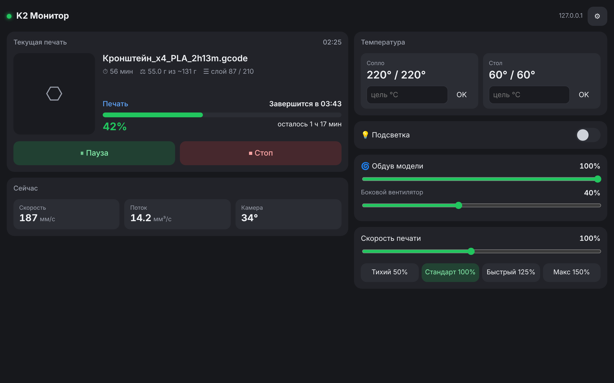
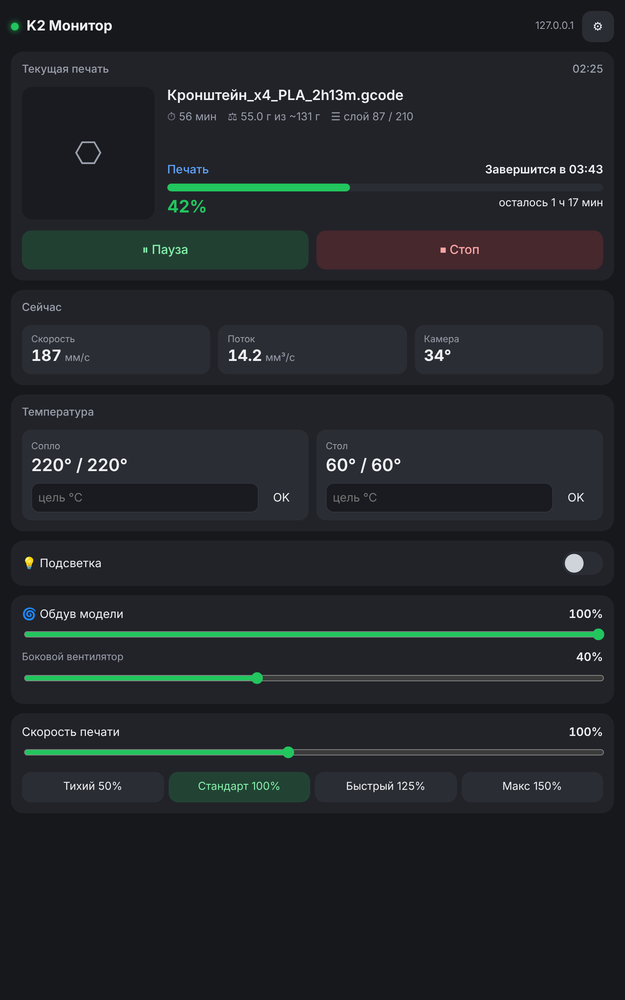
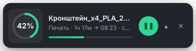
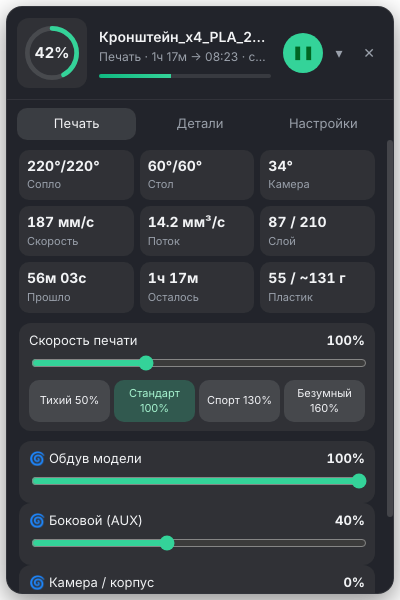
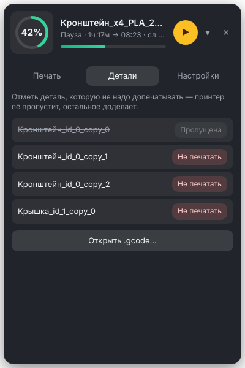
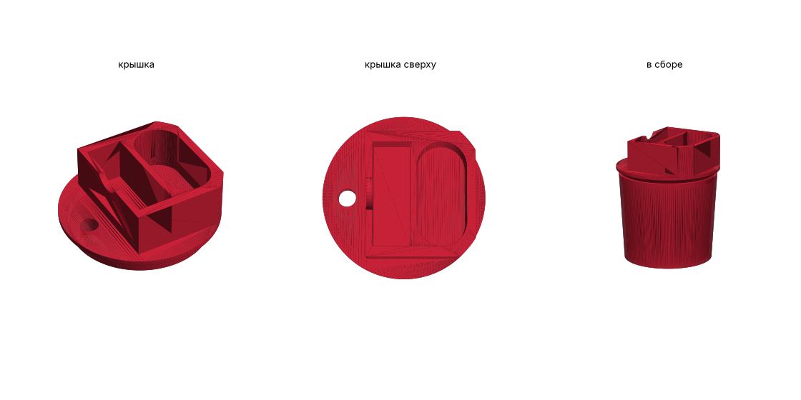

# 🖨️ K2 Monitor — мониторинг и управление 3D-принтером Creality K2

Набор инструментов, чтобы следить за печатью и управлять принтером **Creality K-серии (K2 / K1)**
без открытия слайсера: виджет для Windows, приложение для Android-планшета и пара моделей для печати.

> Статус: **бета**. Всё проверено на эмуляторе принтера. Протокол Creality неофициальный,
> поэтому на некоторых прошивках часть полей может не отображаться.

---

## 📱 K2 Монитор — приложение для Android

Полноценная панель принтера на планшете плюс плашка в шторке и на экране блокировки,
как у музыкального плеера.

<p>
  
  
</p>

**Что умеет:**
- текущая печать: превью модели, имя файла, прогресс, слой, время прошло / осталось, **во сколько закончит**;
- расход пластика в граммах и оценка, сколько уйдёт на всю модель;
- температуры сопла, стола и камеры, установка целевой температуры;
- вкл/выкл подсветки, обдув модели и боковой вентилятор ползунками;
- скорость печати: ползунок и пресеты 50 / 100 / 125 / 150 %;
- пауза / продолжить / стоп (стоп с подтверждением);
- **фоновое уведомление**: прогресс, время, слой и кнопка «Пауза» прямо из шторки, уведомление «Печать готова ✓»;
- режим «не гасить экран»: планшет можно повесить у принтера как табло;
- автопоиск принтера в локальной сети.

**Скачать:** [K2-Monitor.apk](https://github.com/Valentine6383/Tradex-Tariffs/releases/download/k2-monitor/K2-Monitor.apk)

Стек: Kotlin (foreground-служба, уведомления, OkHttp WebSocket) + WebView-интерфейс на HTML/CSS/JS.
APK собирается автоматически через GitHub Actions ([workflow](.github/workflows/android.yml)).
Код: [`android/`](android/)

---

## 🖥️ K2 Widget — мини-плеер для Windows

Компактный виджет поверх всех окон. Сам всплывает, когда начинается печать,
и прячется в трей, когда принтер простаивает.

<p>
  <br>
  
  
</p>

**Что умеет:**
- всё то же, что панель на планшете: прогресс, время, температуры, скорость, поток, пластик;
- управление скоростью и тремя вентиляторами, пауза / стоп;
- **пропуск отдельных деталей** прямо во время печати (Klipper `EXCLUDE_OBJECT`): список берётся с принтера или из .gcode-файла (можно перетащить на виджет);
- автопоиск принтера в сети, автозапуск с Windows, запоминание позиции на экране;
- сохранение лога обмена с принтером для отладки.

Стек: Electron + Node.js (`ws`), сборка в портативный .exe через `@electron/packager`.
Есть эмулятор принтера и автотест со скриншотами ([`k2-widget/tools/`](k2-widget/tools/)).
Код: [`k2-widget/`](k2-widget/)

```bash
cd k2-widget
npm install
npm run mock    # эмулятор принтера на 127.0.0.1:9999
npm start       # запустить виджет
npm run dist    # собрать .exe для Windows
```

---

## 🚗 Органайзер-пепельница в подстаканник (STL)

Параметрическая модель: конусный стакан под автомобильный подстаканник и крышка
с карманами под пачку стиков и IQOS/вейп, плюс отверстие для окурков.
Печатается без поддержек.



Все размеры задаются в начале [`cupholder/make.py`](cupholder/make.py) (Python, manifold3d),
готовые файлы: [`stakan.stl`](cupholder/stakan.stl), [`kryshka.stl`](cupholder/kryshka.stl).

---

## ⚙️ Как это работает

Принтеры Creality K-серии поднимают в локальной сети WebSocket на порту `9999`. Через него
с принтером общается и Creality Print. Приложения подключаются к нему напрямую, получают
JSON с состоянием (температуры, прогресс, слои, вентиляторы) и отправляют команды:
паузу, стоп, скорость (`M220`), вентиляторы (`M106`), температуры (`M104` / `M140`).
Облако и интернет не нужны, всё работает внутри домашней сети.
